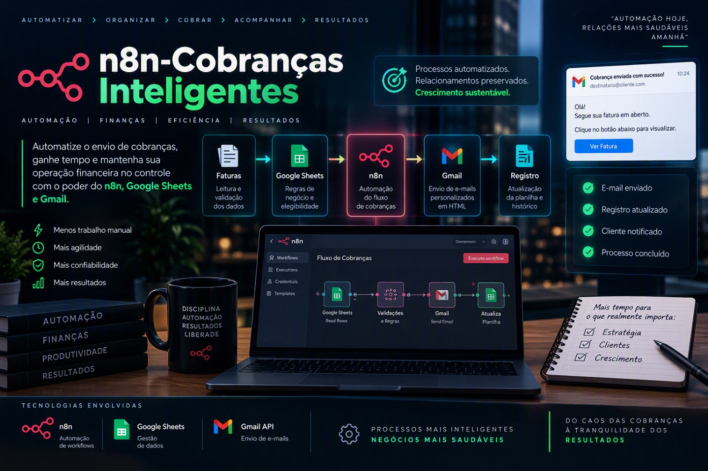

  

  
  
  
  
  
  
  
  
  
  
  
  
  
  
  

# n8n-Cobranças Inteligentes

> **AI Engineer | Especialista em Governança 4.0 e Qualidade | Engenheiro Químico**  
> [Mauá, SP](mailto:ornelas.tozato@gmail.com) | [LinkedIn](https://www.linkedin.com/in/rafaeltozato81) | [GitHub](https://github.com/Rafael-TOZATO) | [Portfólio PWA](https://tozato-dev-hub.vercel.app) | [Medium](https://medium.com/@ornelas.tozato)

> **Governança Técnica:** Branch protection ativa  
> **Contexto do Projeto:** Desafio Criativo desenvolvido na plataforma DIO (Digital Innovation One).  

Automação financeira inteligente com n8n, Google Sheets e Gmail.

## 📋 Objetivo do Projeto

Projetar e estruturar um fluxo de trabalho automatizado para o envio de faturas e cobranças vencidas, garantindo confiabilidade, tratamento adequado de exceções e eficiência operacional para a equipe financeira.

O workflow realiza a leitura das faturas, aplica regras de validação e elegibilidade, gera uma mensagem de cobrança em HTML, envia o e-mail ao cliente e registra o envio na planilha.

## 🛠️ Ferramentas e Escopo

- **Público responsável:** Equipe financeira e de atendimento ao cliente.
- **Ferramentas envolvidas:**
  - Google Sheets
  - n8n
  - Gmail API

## 🔄 Fluxo de Automação

O processo é executado automaticamente todos os dias às 08:00.

## ☁️ Homologação e Ambiente Nuvem (Governança 4.0)

Este repositório passou por auditoria e validação estrutural no ambiente de execução em nuvem **Replit**, garantindo:
- Configuração correta do runtime do n8n com isolamento de dependências.
- Importação segura da base local mantendo os fluxos críticos de envio inativos por padrão, prevenindo disparos acidentais ou cobranças duplicadas.
- Validação de rotas e consistência da estrutura para testes ponta a ponta com dados homologados.

## 🛡️ Governança 4.0 — Segurança e Qualidade

Este repositório adota controles automatizados de Governança 4.0 para assegurar integridade dos artefatos e do código, rastreabilidade das alterações, gestão de dependências e prevenção de exposição de credenciais.

* **Automação de Qualidade e Segurança:** Análises automatizadas e portas de verificação (*status checks*) ativas em segundo plano.
* **Fluxo Sem Atrito:** Dispensa de aprovações manuais redundantes com *auto-merge* habilitado para agilizar entregas.
* **Integridade de Código:** Proteção de branch e bloqueio de *force pushes* para garantir a estabilidade da base principal.

## 📬 CONTATOS E PERFIS

💻 **PROJETOS E PORTFÓLIOS**
* Ecossistema de Aplicativo: [tozato-ai-core.vercel.app](https://tozato-ai-core.vercel.app)
* H-Folio Professional: [h-folio-I0.vercel.app](https://h-folio-I0.vercel.app)

🐙 **CÓDIGOS E REPOSITÓRIOS**
* GitHub: [github.com/Rafael-TOZATO](https://github.com/Rafael-TOZATO)

✍️ **ARTIGOS E PUBLICAÇÕES**
* Medium: [medium.com/@ornelas.tozato](https://medium.com/@ornelas.tozato)
* Comunidade DEV: [dev.to/rafaeltozato](https://dev.to/rafaeltozato)

💼 **CONTATO**
* LinkedIn: [linkedin.com/in/rafaeltozato81](https://www.linkedin.com/in/rafaeltozato81)
* E-mail: ornelas.tozato@gmail.com
